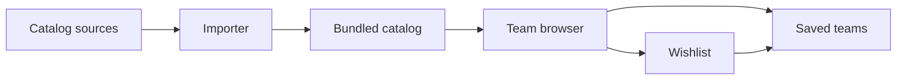

# Champion's Atlas

Champion's Atlas is a SvelteKit app for finding, editing, and saving
Pokémon Champions doubles teams. It combines set filters with
credential-based ordering without claiming legality validation.



## Overview

A personal-first, mobile-friendly team browser that combines Pokémon and set
filters with regulation-aware result ordering. Browse without a team in mind,
find teams around a preferred core, and keep your current teams locally.

The browser includes a VGCPastes M-C/M-B snapshot, combined Pokémon and set
filters, credential-based result ordering, and team details. Filters, sorting, and
browsing position survive opening a team and returning. Saved teams, similarity
comparison, and set-text editing work locally. Legality validation and PWA
installation remain unimplemented. See
[the product specification](docs/product-spec.md) for agreed behavior and milestones.

## Development

```sh
mise install      # Install the project’s Node runtime.
npm ci            # Install locked dependencies and Git hooks.
npm run dev       # Start the local development server.
```

Use the Node 24 LTS environment selected by mise. `npm ci` installs Lefthook hooks.
SvelteKit 3 configuration is passed to `sveltekit()` in `vite.config.ts`.
The `#lib/*` alias requires explicit extensions, such as `.js`, `.ts`, and
`.svelte`. `tsconfig.json` scopes TypeScript checks to `src` and `vite.config.ts`.

```sh
make ci           # Run lint, formatting, types, build, and Node tests.
```

This runs ESLint, Prettier verification, `svelte-check`, the production build,
and importer/filter/ranking tests plus a server-rendering smoke test.
`npm test` requires a build first. Browser checks run separately and in CI:

```sh
npx playwright install chromium webkit
npm run test:e2e:smoke # Run eight critical scenarios across 15 browser cases.
npm run test:e2e       # Run the full browser suite.
```

These cover desktop and mobile filtering, details, Back/Forward, reload, and
invalid links, saving, comparison, editing, and export against an E2E build.
CI runs smoke coverage on pull requests and pushes to `main`. To run the full
suite remotely, select **Actions → CI → Run workflow**. Every CI event retains
`make ci`, Chromium and WebKit installation, and failure traces. Deployment
workflows run independently of CI.

Both browser commands disable Firebase and enable `E2E_CATALOG_FIXTURE=1` to
isolate a deterministic custom-rule roster in the bundled catalog. The overlay
does not modify generated catalog data or normal production builds.
Use `npm run format` to format files and `npm run preview` to serve a built app.

## Layout

| Path          | What                                                  |
| ------------- | ----------------------------------------------------- |
| `src/routes/` | Pages and global styles                               |
| `src/lib/`    | Components, team logic, and generated catalog         |
| `scripts/`    | Catalog import, enrichment, and maintenance commands  |
| `test/`       | Node tests and built-app smoke checks                 |
| `e2e/`        | Desktop and mobile browser tests                      |
| `static/`     | App icons and cached Pokémon assets                   |
| `docs/`       | Product behavior, data sources, and deployment guides |

## Catalog

The generated catalog is ignored by Git. `npm run dev`, `npm run build`, and
`npm run typecheck` automatically import it when missing, then reuse it unchanged.
A clean checkout needs network access for the initial import unless source files
are already cached. The built app uses the bundled snapshot without fetching
source data at runtime.

Regenerate or refresh explicitly with:

```sh
npm run import:catalog
REFRESH=1 npm run import:catalog
OFFLINE=1 npm run import:catalog
```

The importer caches source files in `.cache/catalog`; `REFRESH=1` refreshes
spreadsheet metadata. `OFFLINE=1` requires cached files. `PASTE_LIMIT` controls
how many recent teams to fetch when explicitly set; by default every team gets
full paste details. Already loaded compatible sets survive partial imports.
Species and items are available for every imported team; moves, abilities, and
spreads require an enriched paste. Unknown details never satisfy a filter.
Imports replace the catalog atomically. Invalid spreadsheet data fails the
import. Individual paste failures are reported on the team and in importer output;
compatible previous sets are retained, otherwise details remain unknown.
Pokémon sprites and 24px item icons are cached under ignored `static/` folders
during catalog bootstrap. Missing or invalid images fail independently without
changing catalog data; item names remain visible when icons are unavailable.

The app renders decorative sprites and item icons only when their PNG files exist
in the local asset inventory captured at development server startup or build time. Missing
sprites render nothing; missing item icons show a dash. Names remain visible, and
absent files trigger no image requests. Restart the development server or rebuild
after synchronizing additional images. Importer download failures remain visible.

Preview imports request live source refreshes with `CHECK_SHEET=1` and enable
`ALLOW_STALE_SOURCE_CACHE=1`. If a refresh fails with an eligible transient HTTP
or network error, the importer warns and reuses validated raw source cache,
including spreadsheet CSVs. Existing request retries remain unchanged.
Missing, unreadable, invalid, or oversized fallback
cache still fails the source load. Fresh validation and cache-write failures stay
fatal; mandatory-source failures stop the import without replacing the catalog.
Production, CI, and local imports remain strict unless you explicitly set this
flag. It does not change offline behavior or impose a cache age limit.

See [data sources and ranking limits](docs/data-sources.md) for source
interpretation, ranking, and catalog freshness.

## Save, compare, and edit

Open a catalog team and choose **Use this team**, or choose **Add custom team**
in **My teams** and paste a complete six-Pokémon export from
[Pokémon Showdown Teambuilder](https://play.pokemonshowdown.com/teambuilder).
Custom imports require an item, ability, nature, EVs, and four unique moves for
every Pokémon. They have no published result claims; legality is unverified.

Choose **Wishlist** on a catalog card to bookmark a team without adding it to
My teams. **Wishlist** on **My teams** lists those bookmarks. **Use this
team** there, in Browse, or on a team page moves the same saved team into
My teams; **Remove from Wishlist** deletes only the bookmark. A bookmark whose
source team left the catalog stays usable and shows its saved roster without
catalog details. Bookmarks never appear in the My teams picker.

**My teams** selects among in-use teams with an icon-first search field. Type a
team name or any of its Pokémon to filter and rank the list, then choose a result
with the arrow keys and Enter; Escape restores the current team without renaming
it.

Select a field on a saved team card to edit its set. Completed text saves on blur
or Enter; selections and suggestions save immediately when the whole set is
valid. Changed EV spreads must total 66 points. The full-height EV slider retains
keyboard controls and vertical scrolling; **Fill** adjusts only the selected
stat toward 66, within its 0–32 bounds. **Done** saves valid pending input and
closes the editor; **Close** offers to discard only invalid or failed-write
input. Earlier autosaves remain saved. There is no separate Apply step.
**Advanced set text** replaces the set explicitly. Structured edits retain
nicknames and supported untouched set lines. Unknown values are never guessed.

Item and ability suggestions are buttons after their labeled text fields.
Use Tab to reach a suggestion and Enter to select it. Operation failures use
alerts; successful actions use status messages.

In the **My teams** overview, **Record in-game set** records a Pokémon's
committed set as the one currently in your Pokémon Champions box. **Record all
in-game sets** records the selected team's six sets in one operation. Both use
the Save icon and appear only when recording would change a snapshot. Recording
changes only Champion's Atlas, never Pokémon Champions, and does not save the
team itself. These actions are unavailable while editing. Individual
replacements ask for confirmation. Bulk recording shows a checklist of different
recorded sets, initially unchecked: select one, several, all, or none to replace.
Unchecked Pokémon keep their recorded sets; selecting none still records new
Pokémon. New or identical snapshots do not prompt, and identical snapshots do
not show a Record action. **Cancel** records nothing.

Snapshots use one slot per Browse identity, shared by a base Pokémon and its
Mega. Ordinary Floette and Floette-Eternal have separate slots. Team edits do
not update snapshots, and deleting a team does not delete them. The app does
not seed snapshots from teams or keep history. When a snapshot exists, its
values appear as source-labelled choices in the editor's existing field
suggestions. Selecting a choice changes only that field, except that a spread
choice changes the spread and nature together. The editor also offers a
whole-set suggestion with a preview of the changes, including raw set text and
saved metadata when they differ. You must select the suggestion to apply it;
saved team cards have no direct reuse action.

The card’s **Revert changes** action appears only when it can restore that slot
to its state when you opened the team. It stays hidden for unchanged sets,
while editing or deleting, and when restoring would cause a roster conflict.

Expand **Original & history** to compare your current team with the original and
restore the original, including name, sets, and roster order. **Restore original
set** changes only that slot and is unavailable when it would duplicate a
Pokémon or exceed the replacement Mega limit. Whole-team restoration does not
change the saved ID or source history.

Original source metadata is kept when saving a catalog team and shown as evidence
for the original, not the edited version. Older saved teams show only metadata
they retained. Custom teams show their starting team without public source claims.
Original field and complete EV/nature suggestions lead the corresponding lists;
catalog suggestions follow without duplicate pairs. Benchmark answers and
**Speed tiers** retain their existing mechanics and limits.

**Copy team text** exports current sets, normalizing EVs out of 32 and omitting
IVs, level, and Tera Type for Pokémon Champions. Unknown fields are omitted.
Edited teams do not receive a new rental code. Saved copies survive reload and
catalog refreshes on the same browser origin; clearing browser storage removes
them. Saving requires available browser storage. Only unsaved input prompts
before navigation. Browse filters and position remain device-local.

When Firebase is configured, Google sign-in synchronizes saved teams, their
originals, and current Pokémon set snapshots across devices. Without
configuration the app runs local-only. See [Firebase deployment and sync](docs/firebase.md)
for the separate current-set registry and rules-before-client release
requirement.

## Stack

- Svelte 5, SvelteKit, strict TypeScript.
- daisyUI with Tailwind CSS, bits-ui primitives, locally bundled Inter font.
- ESLint with Svelte rules, Prettier with Svelte and Tailwind plugins, svelte-check.
- mise, Lefthook, GitHub Actions, Dependabot following mw-kit conventions.

ESLint and Prettier are the agreed exception to mw-kit's Biome default for
Svelte-specific support. UI components are editable under `src/lib/components/ui`.
Internal links passed to Button must use SvelteKit's `resolve()` at the call site.

TypeScript stays on 6.0.3 until svelte-check and typescript-eslint support
TypeScript 7. Their current peer dependency ranges exclude version 7.

Deployment uses `@sveltejs/adapter-static` to build a static SPA that Firebase
Hosting serves. See [Firebase deployment and sync](docs/firebase.md).
